# Synedrios — AI Meeting Participant

*From Greek συνέδριος (synedrios): one who sits together in council.*

An AI entity that joins meetings as a participant — not a note-taker, not a transcription service, but a contributor with defined roles, strengths, and rules of engagement. LLM-agnostic, containerised, persistent.

---

*For someone deciding whether to put an AI participant in their meetings.
Sections 1–3 are non-technical; the design begins at "Core Thesis". Already
decided? `docs/USER_GUIDE.md`.*

## 1. Motivation

Every meeting-AI product on the market — Otter, Fireflies, Granola, Fathom —
does the same thing: it listens, it transcribes, it summarises afterwards. It
is a recorder. Nobody in the meeting is helped *during* the meeting by a
recorder, and the summary arrives after the decisions were made.

The thing a meeting could actually use is another participant: one who
remembers everything that was ever said in this series of meetings, notices
when today's plan contradicts last month's decision, says so at the right
moment and not at every moment, and writes the minutes — with the actions, the
decisions, the risks — before anyone has left the room. That is a role, with
rules of engagement, not a feature.

Synedrios is that participant. It joins a meeting with a defined role —
secretary, technical advisor, facilitator, silent observer, coach — that says
when it speaks, what it says, and what it produces afterwards. It works with
any language model, including ones running on your own machine, and it runs as
one container. Phase 1 is text meetings in Slack; the design covers voice and
the video platforms.

## 2. Capabilities

- **Five pre-built roles**, each a contract on when to speak and what to
  deliver: notes, summary, actions, follow-up agenda, risk register, decision
  log, coaching assessment. Roles are YAML; write your own.
- **Persistent memory across meetings** — decisions and people, so the
  participant is the one in the room who remembers.
- **LLM-agnostic**: Claude, GPT, Ollama, vLLM, anything OpenAI-compatible.
- **Start a meeting with one Slack message**, end it with another, and receive
  the outputs in the channel.
- **Operator tooling**: a pre-flight check that refuses to start a meeting the
  storage cannot keep up with, and a calibration tool for reviewing what the
  participant did.
- **Tested**: an automated unit and integration test suite, with lint, type and
  dependency-audit checks (current results: `HANDOVER.md`).

## 3. What this is not

- **Not a transcription service** and not a summariser bolted onto one. If
  that is what you want, the products above are good at it.
- **Not voice yet.** Phase 1 is text in Slack; STT, diarisation and the
  Zoom/Teams/Meet connectors are designed, not built.
- **Not proven in a real meeting yet.** The software half of the field test is
  done and rehearsed; the five live meetings with real colleagues are the one
  open item, and they need the owner's workspace.
- **Not a decision-maker.** It contributes and records; the humans decide, and
  the participation model exists to keep it that way.

---

*From here on the document is technical.*

---

## Core Thesis

Every product in the meeting-AI space (Otter, Fireflies, Granola, Fathom) treats AI as a passive recorder. Synedrios treats AI as a **participant with a seat at the table** — one whose strengths (total recall, cross-domain pattern recognition, synthesis under pressure, zero ego investment) and weaknesses (no body language, no political subtext, no emotional intuition) are acknowledged the same way any human participant's would be.

The participation model — when and how the AI contributes — is the product. Everything else is plumbing.

---

## Architecture Overview

```mermaid
flowchart LR
    subgraph CONN["Connector layer"]
        SLACK["Slack Bot (v1)"]
        OTHERS["Zoom / Teams / Meet /<br/>screen-use (later)"]
    end
    subgraph INGEST["Ingest pipeline"]
        STT["STT (audio)"]
        OCR["OCR (screen)"]
        DIAR["Diarisation"]
        CHAT["Chat parser"]
    end
    subgraph ENGINE["Participation engine"]
        MODE["Mode controller"]
        TURN["Turn manager"]
        TRIG["Trigger evaluator"]
        COMP["Response composer"]
    end
    subgraph LLM["LLM adapter layer"]
        ADAPT["adapter.py<br/>(Anthropic, OpenAI-compat,<br/>Ollama, vLLM, LM Studio)"]
    end
    subgraph POST["Post-meeting processor"]
        NOTES["Notes, summary,<br/>action items"]
    end
    subgraph OUT["Output layer"]
        OTXT["Chat text, TTS,<br/>documents, emails"]
    end
    CONN --> INGEST --> ENGINE --> LLM
    LLM --> POST --> OUT
    ENGINE <--> LLM
    subgraph PERSIST["Persistence layer"]
        PG[("PostgreSQL<br/>structured, audit log")]
        CHROMA[("ChromaDB<br/>semantic search")]
        FILES[("File store")]
    end
    ENGINE --> PERSIST
    POST --> PERSIST
```



```
┌─────────────────────────────────────────────────────────────┐
│                     DOCKER CONTAINER                        │
│                                                             │
│  ┌─────────────┐  ┌──────────────┐  ┌────────────────────┐ │
│  │  CONNECTOR   │  │  INGEST      │  │  PARTICIPATION     │ │
│  │  LAYER       │→ │  PIPELINE    │→ │  ENGINE            │ │
│  │             │  │              │  │                    │ │
│  │ Zoom Bot    │  │ STT (audio)  │  │ Mode controller    │ │
│  │ Teams Bot   │  │ OCR (screen) │  │ Turn manager       │ │
│  │ Slack Bot   │  │ Diarisation  │  │ Trigger evaluator  │ │
│  │ Meet Bot    │  │ Chat parser  │  │ Response composer  │ │
│  │ Screen-use  │  │ Screenshot   │  │                    │ │
│  │ (fallback)  │  │ capture      │  │                    │ │
│  └─────────────┘  └──────────────┘  └────────┬───────────┘ │
│                                              │             │
│  ┌─────────────┐  ┌──────────────┐  ┌────────▼───────────┐ │
│  │  OUTPUT      │  │  POST-MEET   │  │  LLM ADAPTER      │ │
│  │  LAYER       │← │  PROCESSOR   │← │  LAYER            │ │
│  │             │  │              │  │                    │ │
│  │ Chat text   │  │ Notes        │  │ Claude API        │ │
│  │ TTS voice   │  │ Summary      │  │ OpenAI API        │ │
│  │ Documents   │  │ Action items │  │ Ollama (local)    │ │
│  │ Emails      │  │ Responses    │  │ vLLM (local)      │ │
│  │             │  │ AI own tasks │  │ LM Studio         │ │
│  │             │  │              │  │ Claude Code (CLI) │ │
│  └─────────────┘  └──────────────┘  └────────────────────┘ │
│                                                             │
│  ┌──────────────────────────────────────────────────────┐   │
│  │  PERSISTENCE LAYER                                    │   │
│  │  PostgreSQL (structured) │ ChromaDB (semantic search) │   │
│  │  File store (recordings, screenshots, docs)           │   │
│  └──────────────────────────────────────────────────────┘   │
└─────────────────────────────────────────────────────────────┘
```

---

## 1. Meeting Modes — The Product Core

Meeting modes are first-class configuration objects, set at the start of a meeting (during introductions, as you specified) or loaded from templates. Each mode defines: what the AI listens for, when it may speak, how it contributes, and what it produces afterward.

### Mode Schema (YAML)

```yaml
meeting:
  title: "Q3 Architecture Review"
  scheduled: "2026-06-15T14:00:00Z"
  duration_minutes: 60

  participants:
    - name: "Nikos"
      role: "Technical Lead"
      pronouns: "he/him"
    - name: "Sarah"
      role: "Product Manager"
    - name: "synedrios"
      role: "Technical Advisor"
      is_ai: true

  mode: "round_robin_discussion"

  ai_participation:
    # When the AI may contribute unprompted
    triggers:
      - type: "addressed_directly"
        priority: 1           # always respond when spoken to
      - type: "factual_error"
        priority: 2           # correct verifiable mistakes
        confidence_threshold: 0.9
      - type: "contradiction"
        priority: 3           # flag when participant X contradicts participant Y
      - type: "synthesis_opportunity"
        priority: 4           # offer synthesis when discussion fragments
        min_unresolved_threads: 3
      - type: "circular_discussion"
        priority: 5           # intervene when same point repeated
        repetition_threshold: 3
      - type: "scheduled_turn"
        priority: 2           # in round-robin, take assigned turn

    # What the AI will NOT do
    constraints:
      - "never_interrupt_mid_sentence"
      - "no_unsolicited_personal_opinions_on_people"
      - "flag_uncertainty_explicitly"
      - "defer_to_domain_expert_when_present"

    # Response style
    style:
      max_contribution_length: "30_seconds"  # or word count
      tone: "direct_technical"               # not diplomatic waffle
      format: "spoken"                       # or "chat_text" or "both"

  post_meeting:
    outputs:
      - type: "meeting_notes"
        format: "markdown"
        style: "structured"        # decisions, discussion points, open questions
      - type: "summary"
        format: "markdown"
        max_words: 500
      - type: "action_items"
        group_by: "owner"          # per-person action lists
        include_ai_actions: true   # what the AI itself needs to do next
        include_mentioned: true    # actions for people mentioned but not present
      - type: "draft_responses"
        recipients:
          - name: "Mike (Engineering)"
            context: "update on architecture decision"
          - name: "Board"
            context: "summary of technical risk discussion"
      - type: "follow_up_questions"
        for: "next_meeting"
```

### Predefined Mode Templates

**lecture_notes** — AI is silent during the meeting. Full transcription. Post-meeting: structured notes, key concepts, questions the lecturer raised but didn't answer, reading list extracted from mentions.

**round_robin** — AI takes a numbered turn like any participant. Contributes opinion, synthesis, or analysis when its turn arrives. May request to speak out of turn by raising a flag (visual indicator) that the chair can accept or dismiss.

**expert_panel** — AI is one of several domain experts. May interrupt (politely) to correct factual errors or offer counter-evidence. Responds to direct challenges. Will argue a position and defend it with citations.

**coaching** — AI observes a practice session (sales pitch, presentation rehearsal, interview prep). Silent during performance. Provides structured feedback afterward: what worked, what didn't, specific improvement suggestions with timestamps.

**presentation** — AI watches slides and listens to presenter. Captures screenshots at slide transitions. Post-meeting: slide-by-slide notes, questions the audience asked, suggested improvements, fact-checks on claims made.

**brainstorm** — AI contributes ideas freely. No turn-taking constraints. Responds to "yes-and" prompts. Flags when the group is converging too early. Offers deliberately contrarian positions when asked.

**decision_meeting** — AI tracks options being discussed, maintains a live decision matrix, flags when criteria are being applied inconsistently, and produces a formal decision record post-meeting.

---

## 2. Connector Layer

### Primary Path: Meeting Bot SDKs

**Recall.ai** is the leading meeting bot SDK. Single integration gives you Zoom, Teams, Google Meet, and Webex. Provides: real-time audio streams with speaker diarisation, meeting chat access, screen share capture. The bot joins as a named participant ("Synedrios") with its own identity. This is the correct architectural choice — proper API access, not screen-scraping.

**Slack Bot API** — native integration for text-based meetings. The bot joins a channel, reads all messages, identifies participants, and contributes according to mode rules. Simplest integration path; ideal for Phase 1.

**Discord Bot API** — similar to Slack. Relevant if your meeting culture is Discord-based. Also supports voice channels with audio streaming.

### Fallback Path: Computer-Use Interface

For platforms with no bot SDK, or for ad-hoc situations where a human is already logged in and wants to add the AI mid-meeting:

- Virtual audio device (PulseAudio loopback) captures system audio
- Periodic screenshots (configurable interval, default 5s during screen share, 30s otherwise)
- OCR on screenshots for text extraction
- Keyboard/mouse automation for posting responses into chat

This works but is brittle. Use it as a last resort, not a selling point. It breaks whenever the conferencing app updates its UI.

### Connector Interface (all connectors implement this)

```python
class MeetingConnector(Protocol):
    """Interface that all meeting connectors must implement."""

    async def join(self, meeting_id: str, credentials: dict) -> None: ...
    async def leave(self) -> None: ...

    # Input streams
    async def audio_stream(self) -> AsyncIterator[AudioChunk]: ...
    async def chat_stream(self) -> AsyncIterator[ChatMessage]: ...
    async def screen_stream(self) -> AsyncIterator[Screenshot]: ...

    # Output
    async def send_chat(self, message: str) -> None: ...
    async def send_audio(self, audio: AudioChunk) -> None: ...
    async def raise_hand(self) -> None: ...
    async def lower_hand(self) -> None: ...

    # Metadata
    async def get_participants(self) -> list[Participant]: ...
    async def get_meeting_info(self) -> MeetingInfo: ...
```

---

## 3. Ingest Pipeline

All input is normalised into a unified **MeetingEvent** stream before reaching the Participation Engine.

```python
@dataclass
class MeetingEvent:
    timestamp: datetime
    event_type: str          # "speech" | "chat" | "slide_change" | "join" | "leave"
    speaker: str | None      # diarised speaker identity
    content: str             # transcribed text, chat message, or OCR result
    confidence: float        # STT confidence score
    media: bytes | None      # screenshot, if applicable
    metadata: dict           # speaker emotion estimate, slide number, etc.
```

### Speech-to-Text Options

| Engine | Latency | Quality | Local? | Cost |
|--------|---------|---------|--------|------|
| Whisper (large-v3) | ~2s | Excellent | Yes | GPU cost only |
| Whisper (turbo) | ~0.5s | Good | Yes | GPU cost only |
| Deepgram | ~0.3s | Excellent | No | ~$0.0043/min |
| AssemblyAI | ~0.5s | Excellent | No | ~$0.0065/min |
| Google Cloud STT | ~0.3s | Good | No | ~$0.006/min |

For local-first deployments: Whisper turbo with faster-whisper (CTranslate2 backend). For lowest latency: Deepgram streaming API. The adapter pattern means you can swap without touching anything else.

### Speaker Diarisation

Critical for the participation engine — you cannot respond to "what Sarah said" if you don't know which audio segments are Sarah's. Options: pyannote.audio (local, excellent), Recall.ai's built-in diarisation (if using their SDK), Deepgram's diarisation (bundled with their STT).

### Screenshot Capture

Triggered by: slide transitions (detected via frame differencing), timed intervals during screen share, explicit request from a participant ("screenshot this"), or mode rules (presentation mode captures every slide).

---

## 4. LLM Adapter Layer

The core abstraction: every LLM backend exposes the same interface to the Participation Engine.

```python
class LLMAdapter(Protocol):
    """Uniform interface for all LLM backends."""

    @property
    def context_window(self) -> int: ...

    @property
    def supports_streaming(self) -> bool: ...

    @property
    def supports_tool_use(self) -> bool: ...

    @property
    def supports_vision(self) -> bool: ...

    async def complete(
        self,
        messages: list[Message],
        system: str,
        tools: list[Tool] | None = None,
        max_tokens: int = 2048,
        temperature: float = 0.7,
    ) -> CompletionResult: ...

    async def stream(
        self,
        messages: list[Message],
        system: str,
    ) -> AsyncIterator[str]: ...
```

### Backend Implementations

**AnthropicAdapter** — Claude API. Best tool use, large context (200k tokens), strong structured output. Primary recommendation for production.

**OpenAIAdapter** — GPT-4o / o3. Good alternative. Different strengths in certain domains.

**OllamaAdapter** — Local models via Ollama. Llama 3, Mistral, Qwen, etc. Context windows vary (8k–128k). No API costs. Requires GPU for acceptable latency. Models persist on disk — no redownload after container restart.

**VLLMAdapter** — High-throughput local inference. Better than Ollama for concurrent requests. Same model ecosystem.

**LMStudioAdapter** — Desktop-friendly local inference. Good for development.

**ClaudeCodeAdapter** — Wraps Claude Code CLI. Useful when the meeting involves code review or architecture discussion and you want Claude Code's agentic capabilities (file reading, code execution) available during the meeting.

### Context Window Management

This is where LLM-agnosticism gets hard. A 200k-token Claude can hold an entire 2-hour meeting transcript. An 8k-token local model cannot. The adapter layer must handle this transparently:

```python
class ContextManager:
    """Manages what the LLM sees, given its context budget."""

    def build_context(
        self,
        budget: int,                    # tokens available
        meeting_config: MeetingConfig,  # mode, roles, rules
        transcript: list[MeetingEvent], # full transcript
        current_trigger: Trigger,       # why we're generating now
    ) -> list[Message]:
        # Priority allocation:
        # 1. System prompt + meeting rules + participant roster (fixed)
        # 2. Last N minutes of transcript (sliding window)
        # 3. Key decisions/points extracted so far (compressed)
        # 4. Relevant prior meeting context from memory (if available)
        # 5. Screenshots of current/recent slides (if vision-capable)
        ...
```

For small-context models, the Context Manager maintains a running **compressed summary** (updated every 5 minutes) plus a sliding window of recent raw transcript. The summary is itself generated by the LLM during quiet moments, so it reflects the model's own understanding.

---

## 5. Participation Engine

The brain. Evaluates the MeetingEvent stream against the mode configuration and decides: should the AI speak now? If yes, what should it say?

```python
class ParticipationEngine:
    """Core decision loop for AI meeting participation."""

    async def run(self):
        async for event in self.event_stream:
            self.transcript.append(event)
            self.update_state(event)

            triggers = self.evaluate_triggers(event)

            if triggers:
                highest = max(triggers, key=lambda t: t.priority)

                if self.turn_manager.can_speak(highest):
                    response = await self.compose_response(highest)
                    await self.output.deliver(response)
                    self.turn_manager.record_contribution()

    def evaluate_triggers(self, event: MeetingEvent) -> list[Trigger]:
        """Check all configured triggers against current state."""
        fired = []
        for trigger_config in self.config.ai_participation.triggers:
            match trigger_config.type:
                case "addressed_directly":
                    if self.is_addressed_to_ai(event):
                        fired.append(Trigger(trigger_config, event))

                case "factual_error":
                    if error := self.detect_factual_error(event):
                        if error.confidence >= trigger_config.confidence_threshold:
                            fired.append(Trigger(trigger_config, event, error))

                case "contradiction":
                    if contradiction := self.detect_contradiction(event):
                        fired.append(Trigger(trigger_config, event, contradiction))

                case "circular_discussion":
                    if self.repetition_count >= trigger_config.repetition_threshold:
                        fired.append(Trigger(trigger_config, event))

                case "synthesis_opportunity":
                    if self.unresolved_threads >= trigger_config.min_unresolved_threads:
                        fired.append(Trigger(trigger_config, event))

                case "scheduled_turn":
                    if self.turn_manager.is_ai_turn():
                        fired.append(Trigger(trigger_config, event))
        return fired
```

### Turn Manager

Prevents the AI from dominating. Tracks: time since last AI contribution, number of AI contributions vs. human contributions, whether the AI was explicitly asked to be quiet, whether the meeting chair has acknowledged a raised hand.

```python
class TurnManager:
    min_silence_after_contribution: timedelta  # don't speak again for N seconds
    max_contributions_per_10min: int           # hard cap
    requires_chair_approval: bool              # for hand-raise modes
    cooldown_after_interruption: timedelta     # longer cooldown if AI interrupted
```

---

## 6. Post-Meeting Processor

Activated when the meeting ends (connector reports meeting closed, or chair says "let's wrap up", or scheduled end time reached).

### Pipeline

1. **Final transcript assembly** — merge all MeetingEvents into a clean, speaker-attributed transcript with timestamps.

2. **Meeting notes** — structured extraction: decisions made, discussion points (with who argued what), open questions, parking lot items, references mentioned (papers, documents, URLs, people).

3. **Summary** — configurable length. Executive summary for forwarding to people who weren't there.

4. **Action items** — the critical output. Grouped by owner:

```yaml
action_items:
  - owner: "Nikos"
    items:
      - task: "Review the API rate limiting proposal"
        deadline: "2026-06-20"
        context: "Agreed during architecture discussion at 14:23"
      - task: "Send database migration plan to Sarah"
        deadline: "2026-06-17"
        context: "Sarah requested this at 14:45"

  - owner: "Sarah"
    items:
      - task: "Schedule follow-up with legal on data residency"
        context: "Raised by Nikos at 15:02, Sarah volunteered to handle"

  - owner: "Mike (not present)"
    items:
      - task: "Update CI pipeline for new test suite"
        context: "Nikos and Sarah agreed Mike should handle this"

  - owner: "synedrios"
    items:
      - task: "Research PostgreSQL partitioning strategies for time-series data"
        context: "Nikos asked for analysis before next meeting"
      - task: "Draft comparison document: Redis vs Memcached for session cache"
        context: "Discussion at 14:38, no conclusion reached"
```

5. **Draft responses** — for each configured recipient, generate a contextually appropriate message (email, Slack message, etc.) summarising what's relevant to them. Drafts, not sends — a human reviews before dispatch.

6. **AI self-tasking** — the AI identifies work it should do before the next meeting, based on what was discussed. Research tasks, document preparation, analysis. These go into its own persistent task queue.

---

## 7. Persistence Layer

### Structured Storage (PostgreSQL)

```
meetings           — meeting metadata, config, timestamps
participants       — people the system has encountered across all meetings
transcripts        — raw event streams, speaker-attributed
action_items       — tasks with owners, deadlines, completion status
ai_tasks           — the AI's own task queue
meeting_artifacts  — generated notes, summaries, documents
relationships      — who knows whom, who reports to whom, org context
```

### Semantic Memory (ChromaDB)

Vector embeddings of: transcript segments, meeting summaries, action items, participant statements. Enables: "What did Sarah say about database migration across all meetings?" or "Find every decision we made about the API in the last quarter."

### File Storage (mounted volume)

Audio recordings (if consent given), screenshots, generated documents (notes, summaries, response drafts), meeting mode templates.

### Persistence Guarantees

- All data survives container restart (Docker volumes).
- Local LLM weights stored on a persistent volume — no redownload.
- ChromaDB index persists — no re-embedding.
- Incremental backups via configurable schedule.

---

## 8. Docker Architecture

```dockerfile
# Multi-stage build
FROM python:3.12-slim AS base

# System dependencies for audio processing, OCR
RUN apt-get update && apt-get install -y \
    ffmpeg \
    tesseract-ocr \
    pulseaudio \
    && rm -rf /var/lib/apt/lists/*

# Python dependencies
COPY requirements.txt .
RUN pip install --no-cache-dir -r requirements.txt

# Application code
COPY src/ /app/src/
COPY config/ /app/config/

WORKDIR /app
ENTRYPOINT ["python", "-m", "synedrios"]
```

```yaml
# docker-compose.yml
services:
  synedrios:
    build: .
    volumes:
      - synedrios-data:/app/data          # PostgreSQL, ChromaDB, files
      - synedrios-models:/app/models      # local LLM weights (persistent)
      - synedrios-config:/app/config      # meeting templates, credentials
    ports:
      - "8080:8080"                       # web UI for configuration
      - "8081:8081"                       # API for external integrations
    environment:
      - ANTHROPIC_API_KEY=${ANTHROPIC_API_KEY}
      - OPENAI_API_KEY=${OPENAI_API_KEY}
      - RECALL_API_KEY=${RECALL_API_KEY}
      - DEEPGRAM_API_KEY=${DEEPGRAM_API_KEY}
    deploy:
      resources:
        reservations:
          devices:
            - driver: nvidia              # GPU passthrough for local LLMs
              count: 1
              capabilities: [gpu]

  postgres:
    image: postgres:16
    volumes:
      - synedrios-db:/var/lib/postgresql/data
    environment:
      - POSTGRES_DB=synedrios
      - POSTGRES_PASSWORD=${DB_PASSWORD}

  chromadb:
    image: chromadb/chroma:latest
    volumes:
      - synedrios-vectors:/chroma/chroma

volumes:
  synedrios-data:
  synedrios-models:
  synedrios-config:
  synedrios-db:
  synedrios-vectors:
```

### GPU Configuration for Local LLMs

Without GPU: API-only backends (Claude, OpenAI, Deepgram). Perfectly functional, no local inference.

With NVIDIA GPU: Ollama or vLLM for local LLM inference, Whisper for local STT, Piper for local TTS. Full offline capability.

---

## 9. Web UI

A configuration and monitoring interface, not the meeting interface itself. The AI participates through the meeting platform's native UI (Zoom chat, Slack channel, etc.).

The web UI provides:

- **Meeting setup** — select mode template, configure participants, set triggers, schedule.
- **Live monitor** — during a meeting, shows the transcript, trigger evaluations (why the AI chose to speak or stay silent), and a manual override panel (force the AI to speak, silence it, change mode mid-meeting).
- **Post-meeting review** — browse notes, action items, summaries. Edit before distributing.
- **Memory browser** — search across all past meetings semantically.
- **AI task queue** — review and manage the AI's self-assigned tasks.
- **Settings** — LLM backend configuration, API keys, connector credentials, default preferences.

---

## 10. Build Phases

### Phase 1 — Text MVP (weeks 1–4)

**Goal:** Prove the participation model works.

- Slack bot connector only
- Single LLM backend (Claude API)
- Three modes: round_robin, lecture_notes, brainstorm
- Meeting config via YAML files (no web UI yet)
- Post-meeting: notes + action items as Slack messages
- SQLite for persistence (upgrade to PostgreSQL later)
- Docker container, runs locally

**Delivers:** A working AI participant in text-based Slack meetings.

### Phase 2 — Voice-in, text-out (weeks 5–10)

**Goal:** Join real video calls, contribute in writing.

- Recall.ai integration (Zoom + Teams + Meet)
- Real-time STT (Deepgram streaming)
- Speaker diarisation
- Screenshot capture on slide transitions
- AI contributes via meeting chat sidebar
- Web UI for meeting setup and live monitoring
- PostgreSQL + ChromaDB
- Post-meeting document generation (markdown files)
- Add OpenAI and Ollama adapters

**Delivers:** AI joins a Zoom call, listens to everyone, contributes in the chat.

### Phase 3 — Full voice participant (weeks 11–16)

**Goal:** AI speaks aloud in the meeting.

- TTS integration (ElevenLabs or Piper for local)
- Turn-taking with audio-level interrupt detection
- Hand-raise protocol for non-interrupt modes
- Full suite of meeting modes
- AI self-tasking with persistent task queue
- Draft response generation for non-participants
- Semantic search across meeting history

**Delivers:** AI as a full speaking participant with memory across meetings.

### Phase 4 — Production hardening (weeks 17–20)

- Multi-meeting concurrency (the AI attends several meetings in parallel)
- Consent management (recording permissions, data retention policies)
- End-to-end encryption option for sensitive meetings
- Admin controls for enterprise deployment
- Comprehensive test suite
- Documentation

---

## 11. Key Design Decisions to Make Early

1. **Identity persistence** — Is Synedrios the same entity across all meetings with the same group, or a fresh instance each time? Recommendation: same entity, with cumulative memory. This is what makes it a participant rather than a tool.

2. **Consent model** — Recording laws vary by jurisdiction. The AI must announce itself and get explicit consent to record/transcribe. This is non-negotiable for production.

3. **Contribution review** — Should a human approve AI contributions before they're spoken/posted? In Phase 1 (text), a brief delay with a "cancel" button is feasible. In Phase 3 (voice), latency makes this impractical. The mode configuration must be trusted.

4. **Multi-LLM routing** — Different tasks within a single meeting could use different backends. Factual queries → large cloud model. Quick acknowledgements → small local model. Code review → Claude Code. This is an optimisation, not a Phase 1 concern.

5. **Emotional intelligence gap** — The AI cannot read tone, facial expressions, or body language. This should be stated explicitly in the AI's introduction at every meeting, the same way a participant with a relevant disability would set expectations. Not a limitation to hide; a characteristic to work around.

---

## 12. Technology Stack Summary

| Component | Primary Choice | Alternative |
|-----------|---------------|-------------|
| Language | Python 3.12 | — |
| Async framework | asyncio + aiohttp | FastAPI for web UI |
| Meeting bot SDK | Recall.ai | Daily.co, Vonage |
| STT | Deepgram (cloud), Whisper (local) | AssemblyAI |
| TTS | ElevenLabs (cloud), Piper (local) | Coqui TTS |
| Diarisation | pyannote.audio | Recall.ai built-in |
| LLM (cloud) | Claude API (Anthropic) | OpenAI |
| LLM (local) | Ollama | vLLM, LM Studio |
| Database | PostgreSQL 16 | SQLite (Phase 1) |
| Vector store | ChromaDB | Qdrant, Weaviate |
| Containerisation | Docker + docker-compose | Podman |
| Web UI | FastAPI + HTMX | React |
| Task queue | Celery + Redis | — |
| Configuration | YAML | — |

---

## 13. File Structure

*The original design sketch, written before Phase 1 was built. Many of these files do not
exist (Phase 1 needed fewer modules), so do not use it to find code. The actual layout is in
`CLAUDE.md` → Project Structure and `README.md` → File Structure.*

```
synedrios/
├── docker-compose.yml
├── Dockerfile
├── requirements.txt
├── README.md
├── config/
│   ├── default.yml              # default system configuration
│   └── modes/                   # meeting mode templates
│       ├── round_robin.yml
│       ├── lecture_notes.yml
│       ├── expert_panel.yml
│       ├── coaching.yml
│       ├── presentation.yml
│       ├── brainstorm.yml
│       └── decision_meeting.yml
├── src/
│   ├── __init__.py
│   ├── __main__.py              # entry point
│   ├── connectors/
│   │   ├── __init__.py
│   │   ├── base.py              # MeetingConnector protocol
│   │   ├── slack.py
│   │   ├── recall.py            # Zoom/Teams/Meet via Recall.ai
│   │   ├── discord.py
│   │   └── screen.py            # computer-use fallback
│   ├── ingest/
│   │   ├── __init__.py
│   │   ├── stt.py               # speech-to-text adapters
│   │   ├── diarisation.py       # speaker identification
│   │   ├── screenshot.py        # screen capture + OCR
│   │   └── events.py            # MeetingEvent dataclass
│   ├── engine/
│   │   ├── __init__.py
│   │   ├── participation.py     # core participation loop
│   │   ├── triggers.py          # trigger evaluation logic
│   │   ├── turns.py             # turn management
│   │   ├── context.py           # context window management
│   │   └── modes.py             # mode loading and validation
│   ├── llm/
│   │   ├── __init__.py
│   │   ├── base.py              # LLMAdapter protocol
│   │   ├── anthropic.py
│   │   ├── openai.py
│   │   ├── ollama.py
│   │   ├── vllm.py
│   │   └── claude_code.py
│   ├── output/
│   │   ├── __init__.py
│   │   ├── chat.py              # text output to meeting chat
│   │   ├── tts.py               # text-to-speech adapters
│   │   └── documents.py         # post-meeting document generation
│   ├── postmeet/
│   │   ├── __init__.py
│   │   ├── processor.py         # post-meeting pipeline orchestrator
│   │   ├── notes.py             # meeting notes generator
│   │   ├── actions.py           # action item extractor
│   │   ├── summary.py           # summary generator
│   │   ├── responses.py         # draft response composer
│   │   └── self_tasks.py        # AI self-tasking
│   ├── persistence/
│   │   ├── __init__.py
│   │   ├── database.py          # PostgreSQL models and queries
│   │   ├── vectors.py           # ChromaDB integration
│   │   └── files.py             # file storage management
│   └── web/
│       ├── __init__.py
│       ├── app.py               # FastAPI application
│       ├── routes/
│       └── templates/
├── tests/
│   ├── test_triggers.py
│   ├── test_context.py
│   ├── test_turns.py
│   ├── test_postmeet.py
│   └── fixtures/
│       └── sample_meetings/     # recorded meeting transcripts for testing
└── docs/
    ├── architecture.md
    ├── modes.md
    ├── deployment.md
    └── api.md
```

---

## Architecture Decisions

Settled product and architecture decisions, with their reasoning, numbered D1–D18. The numbers are stable:
code comments, tests and the development log (not part of the public release) refer to them. Do not relitigate a settled decision without a
recorded reason to reopen it. Append new decisions at the bottom with a date. D12–D14 are **provisional** until the
live T6 meetings confirm or override them. Moved here from `.planning/decisions.md` on 2026-09-15.

### D1 — Open Source Under Business Source License 1.1
**Decision:** Release as open source under BSL 1.1, not as a patented
proprietary product and not under a permissive licence (MIT/Apache).
**Reasoning:** Software patents are impractical in the UK/EU and toxic against
open-source users. BSL prevents cloud providers from strip-mining the code into
a competing managed service (the Elasticsearch/Redis problem) while keeping it
free for internal use. Converts to Apache 2.0 four years after each release.
Primary IP protection is the "Synedrios" trademark, not patents.

### D2 — LLM-Agnostic, Everything via API
**Decision:** No local LLM hosting in the container. Local LLMs (Ollama, vLLM)
reached via their OpenAI-compatible API endpoints.
**Reasoning:** Keeps container under 250 MB, removes GPU dependency, makes
VPC/air-gapped deployment free (point at an internal endpoint). The customer's
choice of model is theirs; we orchestrate.

### D3 — Self-Hosted / VPC Deployment Model
**Decision:** Ship a Docker image the customer runs in their own infrastructure.
Optionally a managed-VPC model later. Avoid hosting customer data ourselves.
**Reasoning:** Data never touches our infrastructure, so SOC2 is not required of
us (£50–100k saved). The customer's own compliance covers their environment.
Enterprise procurement objections ("show us the code", "where does our data
go") are answered by "all of it" and "nowhere — it stays in your VPC".

### D4 — Stateless Workers, Stateful Database
**Decision:** AI identity and memory live in the database; workers are
disposable. NOT one-container-per-avatar.
**Reasoning:** The participation loop is I/O-bound (95% waiting on APIs), so one
async worker handles ~50 concurrent meetings. Scaling to 10k concurrent =
~200 workers loading state from a shared DB, not 10k containers. This is the
only decision that makes enterprise scale economically viable.

### D5 — 5 Roles in v1, 14 Designed
**Decision:** Ship Secretary, Technical Advisor, Facilitator, Silent Observer,
Coach. Design but defer the other 9.
**Reasoning:** These 5 cover ~80% of real meetings and form the learning set.
The custom role builder lets clients approximate the other 9 immediately.

### D6 — GUI Is v1.1, After Phase 1 Is Tested
**Decision:** No GUI in v1.0. Build it after the engine is tested against real
meetings.
**Reasoning:** YAML + Slack commands work for the builder (the owner) to validate
the concept. The GUI is the difference between a dev tool and a product, but
building it before the participation model is proven would be premature
polishing. FastAPI + HTMX when built (single container, no React).

### D7 — Memory Sharing Is Explicit-Grant, Not Hierarchical
**Decision:** Cross-avatar memory access (e.g. CEO's PA accessing executive
team knowledge) is granted explicitly per memory-domain, revocable, and
audited — never inherited automatically by org hierarchy. Deferred to v3.1.
**Reasoning:** Hierarchical inheritance would mean anyone who can prompt a
senior avatar gets that avatar's confidential memories (board discussions,
legal, compensation). Explicit grants prevent silent privilege escalation.

### D8 — B2B/Teams Before B2C
**Decision:** Architecture supports single personal accounts (an org with one
user), but the product, pricing, and go-to-market target B2B/teams first. B2C
launches later as a config/billing tier.
**Reasoning:** Revenue and the owner's sales experience are in B2B. Serving both
audiences at launch risks doing neither well.

### D9 — Side-Channel Alerts, Never In-Meeting Intervention
**Decision:** When the AI detects illegal conduct or dangerous errors, it
alerts a designated human out-of-band (SMS/Slack/email) and never interrupts
the meeting or escalates its initiative level. Client-configurable rules with a
global kill switch. Deferred to v2.
**Reasoning:** The AI has no liability; humans do. Every intervention has a
cost that falls on a human. Detect-and-alert is the legally defensible,
ethically correct role. Clients may also have legitimate reasons to disable all
alerts (e.g. rehearsing a play).

### D10 — Memory-Writing Extraction Design (Resolves Q1, Unblocks T3)
**Decision (2026-06-09, signed off by the owner):** Adopt the proposed v1 design.
After `end meeting`, one LLM pass over the transcript extracts a small capped
set (~10) of high-confidence, durable, typed memories
(person/decision/fact/preference/relationship). Deduplication is an LLM-based
"is this already known?" check against the participant's existing memories
(option b) — acceptable because it runs once per meeting, not per message. No
automatic decay in v1; a newer memory that contradicts an older one is stored
with a reference and the older one's confidence is lowered. Full consolidation
deferred. Memories are injected into the system prompt on subsequent meetings
(already supported by `_build_system_prompt`). Schema must remain avatar-scoped
for v2.1 multi-avatar, even though v1 has a single default avatar.
**Reasoning:** Memory is what makes the avatar a participant rather than a
stateless tool, and the institutional-knowledge moat per docs/scaling.md.
Once-per-meeting cost makes an LLM dedup check affordable and avoids the
embedding-API dependency that exact/paraphrase matching would otherwise force.

### D11 — Factual-Error Detection Calibration (Resolves Q2, Unblocks T2)
**Decision (2026-06-09, signed off by the owner):** Adopt the proposed approach.
A cheap heuristic pre-filter (message contains claim markers: numbers, units,
"is/are/was", named technologies, absolute quantifiers) gates the expensive
LLM detection call. The LLM prompt explicitly distinguishes a verifiable
factual error from opinion/judgement; subjective statements never trigger.
Start conservative (high `confidence_threshold`, default 0.9) and tune down
during T6 real-world testing. Every detection — fired and suppressed
(below-threshold) — is written to the audit log so the threshold can be
calibrated against real data.
**Reasoning:** Running detection on every message is too slow and expensive,
and an over-eager corrector is worse than a silent one. The pre-filter plus a
high threshold biases toward silence; real meetings (T6) provide the data to
calibrate, since model-reported confidence is not inherently well-calibrated.

### D12 — State Triggers Observe a Refractory Period (Provisional, T6)
**Decision (2026-08-25, made during T6 preparation — needs the owner's sign-off):**
`circular_discussion` and `synthesis_opportunity` no longer re-fire on every
message once their condition holds. After either leads to a contribution it
stays quiet for `extra.min_messages_between` messages (default 12).
**Reasoning:** these two triggers describe a *state* of the meeting, not an
event in it. "Several speakers are active" and "some terms are repeating" become
true early in any real meeting and stay true, so an ungated evaluation fires on
every subsequent message. Rehearsal made the consequence concrete: replaying a
100-message planning meeting, the facilitator's triggers fired on essentially
every message and its speaking rate — 31% of all messages — was set entirely by
`max_contributions_per_10min`, not by anything that happened in the meeting. A
throttle is not a participation model. With the refractory gate the triggers
themselves decide, and nothing was blocked by the rate limiter.
**Revisit:** this makes the triggers fire less often, not more meaningfully.
See Q5 — the underlying heuristics still carry little signal.

### D13 — `open_question` Is a Distinct Trigger From `addressed_directly` (Provisional, T6)
**Decision (2026-08-25, made during T6 preparation — needs the owner's sign-off):**
At initiative level 4 and above, an unaddressed question to the room reports as
trigger type `open_question`, not `addressed_directly`. Roles can decline it
entirely with `extra.respond_to_open_questions: false`, which the facilitator
now sets. Direct address is unaffected.
**Reasoning:** two reasons, one of which is not negotiable. The audit log is the
legal record of why the AI spoke (principle 4), and it was recording
`addressed_directly` — "somebody addressed the AI" — for messages where nobody
had; in a 100-message rehearsal, 16 of the facilitator's 30 contributions were
logged that way. The record has to be true. Second, the two cases need separate
labels to be tuned separately in T6: "does it answer when asked" and "does it
butt into other people's questions" are different questions about the model.
Declining open questions is right for a chair specifically — its own config
disables subject-matter opinions, so answering the room's technical questions
contradicts the role.
**Note:** this changes a trigger-type string that P31 asserted on; the test was
updated.

### D14 — Role Throttles Tuned From Rehearsal (Provisional, T6)
**Decision (2026-08-25 — provisional, to be confirmed or overridden by the real
meetings):** `facilitator.yml` moves from cooldown 15 s / 10 contributions per
10 min to 60 s / 4, with `min_messages_between: 15` on both state triggers and
open questions declined. Observed effect in rehearsal: 31% → 12% of messages on
a normal planning replay, 33% → 13% on a circular one.
**Reasoning:** T6 authorises tuning thresholds and cooldowns from observed
behaviour, and the observed behaviour was a chair interrupting every third
message. Starting the first real meeting from the original values would have
guaranteed a bad first impression. These are rehearsal numbers on recorded
transcripts, not real-meeting numbers, so they are a starting point — the real
test can move them in either direction.
**Conflicts with:** the test plan's line for P32, "Facilitator: high rate limit,
short cooldown | Lead behaviour". If that design intent stands, override this.

### D15 — A Question With a Colleague's Name on It Is Never the AI's to Answer
**Decision (2026-08-29, the owner):** no reactive role responds to a question that
was put to a specific colleague. Two forms are recognised, both of which the owner
named: an @-mention of another participant, and a message that opens with a
participant's name ("Sarah, can you check the migration?"). Direct address of
the AI still takes priority, so "Synedrios, do you agree with Mike?" is
answered. This narrows what counts as an open question for every role; it is
not a per-role switch, unlike D13's `respond_to_open_questions`.

**Implementation:** the Slack connector previously deleted `<@Uxxx>` markup
before storing the message, which destroyed the signal — a question aimed at
Sarah reached the engine indistinguishable from one put to the room. Mentions
are now rendered as display names in the transcript (which also reads better in
every post-meeting document) and the addressees recorded in
`metadata["directed_at"]`. The opening-name rule matches against whoever has
spoken in the meeting so far, so it needs no roster.

**Known cost, accepted:** keying on the opening word rather than requiring a
comma means an occasional false positive — "Mike owns billing. Who owns the
mobile hiring track?" opens with a participant's name and is skipped even though
it is a room question. Measured across all eight fixtures: 1 false skip out of
33 questions. Requiring punctuation would fix it but would miss "Sarah what did
the profiler say?", which is how most people type. Staying quiet when the AI
might have spoken is the cheap mistake; answering a question meant for a
colleague is the expensive one, and it is the one the owner ruled out.

### D16 — Version Control Is Local-Only; No GitHub Remote
**Decision (2026-09-03, the owner):** the project uses a plain local git
repository inside the project folder, like the owner's other projects. The
GitHub remote was disconnected and the remote repository deleted. Nothing is
pushed anywhere.
**Consequences, accepted:** (1) the `.github/workflows` CI (tests + weekly
security audit) is dormant — the same gates must be run locally instead:
`pytest`, `ruff`, `mypy`, and periodically `pip_audit --strict` (the weekly
CI job is what caught nothing in August precisely because it never ran; now
it never will, so the local habit matters). (2) The only copy of the
repository lives on this machine — backups are the owner's own arrangement.
The workflow files stay in the tree: they cost nothing and reactivate
automatically if a remote is ever added.

### D17 — `factual_error` Confidence Threshold Lowered to 0.80
**Decision (2026-09-03, the owner, tuning D11):** `confidence_threshold` for the
technical advisor's `factual_error` trigger drops from 0.90 to 0.80.
**Reasoning:** the threshold does not change detection accuracy — it decides
how confident the detector must be before the AI speaks. At 0.90 the AI
stayed silent about a genuinely planted error detected at 0.85 in two
independent live runs. At 0.80 it would have spoken. The cost is more risk
of over-eager corrections; the audit log records every fired and suppressed
detection, so the real meetings will show if 0.80 is too chatty, and the
lever moves back in one line.

### D18 — Negative Person-Memories Are Kept (Resolves Q6)
**Decision (2026-09-04, the owner):** the avatar may store durable negative
observations about named people. This is deliberate and not limited to
technical wrongness: patterns of abusive language or bullying are exactly the
kind of institutional knowledge a meeting participant should retain — a
single incident reads as a bad day, a remembered pattern across meetings is
what makes it recognisable and actionable (and in v2 is what the D9
side-channel alerts would draw on).
**Retained safeguards (already in place, unchanged):** injected memories are
temporally grounded and attributed as prior knowledge, never voiced as
something said in the current meeting; memory confidence and provenance are
audited on creation; the coach role's feedback rules remain "specific,
constructive, never a personal judgement" — remembering a pattern and how the
AI *speaks* about people remain separate questions.

---

## Good to Know

Limits and trade-offs worth knowing before deploying, as of 2026-09-15. Each points at its decision (D) or open
question (Q, in `HANDOVER.md`).

- **Not yet tried with real people.** It has been rehearsed against recorded transcripts and a live Slack workspace;
  the five real meetings (T6) have not happened.
- **Text meetings in Slack only.** Voice and the Zoom, Teams and Meet connectors are designed, not built.
- **It needs a language model**: an API key (Anthropic, OpenAI) or an OpenAI-compatible endpoint such as Ollama or
  vLLM. Detections and the post-meeting pass are model calls. What a meeting costs has not been measured yet.
- **Small local models cannot hold a long meeting.** A model with an 8k-token context cannot fit a two-hour meeting
  (about 25k tokens). The fix, a rolling compressed summary, is designed but not built (Q3).
- **Storage must be fast.** Several database writes happen per message; on a slow disk the participant falls behind
  the conversation, so the pre-flight check refuses to start.
- **The facilitator's flow detection is weak.** "The discussion is going in circles" and "time to synthesise" are
  simple heuristics that are true most of the time; a refractory period stops them dominating, but they fire more on
  a timer than on evidence (D12, Q5).
- **Questions.** Reactive roles answer questions put to the room (the facilitator does not, D13), and never a
  question aimed at a named colleague. That rule skips about 1 room question in 33 by mistake (D15). Whether roles
  should answer room questions at all is open (Q4).
- **Thresholds are provisional.** Detection thresholds and role throttles were tuned on rehearsals, not real
  meetings, and a model's self-reported confidence is not calibrated (D11–D14, D17). The audit log records every fired
  and suppressed detection so they can be retuned.
- **It remembers people, including negative patterns.** Durable observations about named participants are kept,
  including patterns such as abusive language or bullying (D18). Whoever deploys it holds personal data about their
  meeting participants and carries the data-protection duties that come with that.
- **Consent handling is not built.** The participant introduces itself at the start of each meeting; recording
  permissions and data-retention policies are Phase 4 work.
- **One organisation per install.** Every table carries `organisation_id`, but separation between organisations is
  not enforced (v2.1).
- **Licence: Business Source License 1.1.** Free to run for your own organisation; offering it to others as a hosted
  service needs a commercial licence. Each release converts to Apache 2.0 four years after it is published (D1).
